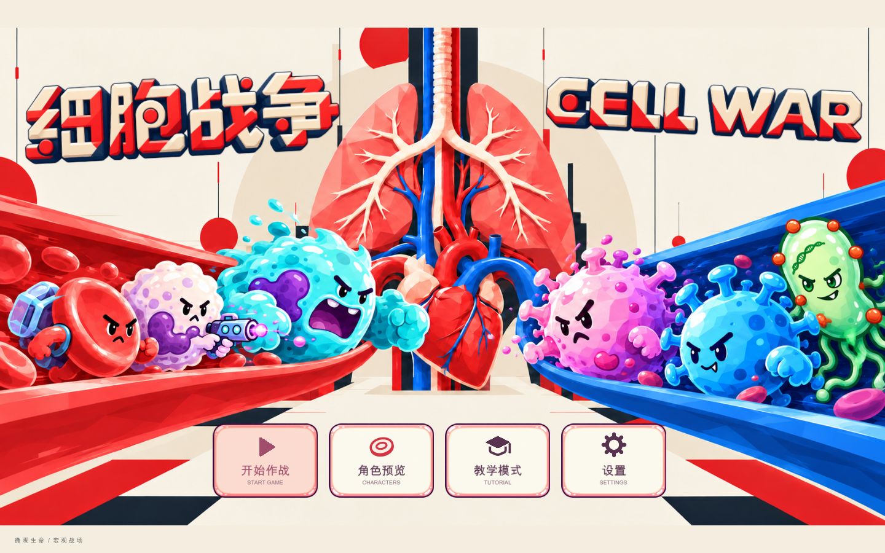
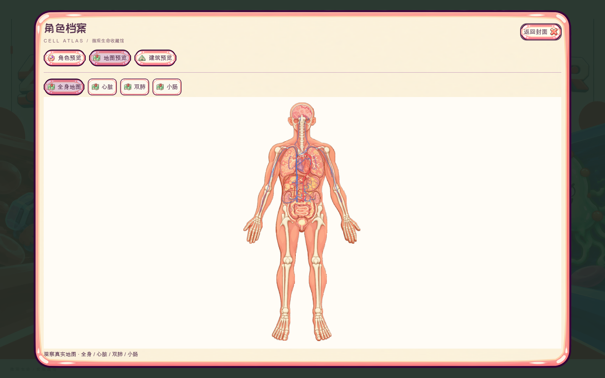

# 细胞战争 · CELL WAR

**在一个身体里，守住整个世界。**

以人体为战场的单人生存即时战略游戏

<code>Godot 4.6+</code> · <code>GDScript</code> · <code>2D</code> · <code>离线游玩</code>

[走进细胞战争](#走进细胞战争) · [游戏画面](#游戏画面)

你是「人体防卫部」的指挥官。

让背着氧气和葡萄糖的红细胞奔赴前线，为免疫细胞建立补给、训练与支援；
在器官与血管之间调度部队，阻止流感扩散，把被感染的组织一点点夺回来。
身体之外，工作、休息与生活选择也会影响体内的这场战斗。

## 走进细胞战争

### 从一条左肺防线开始

新局从左肺上部开始，拥有核心胞巢和 20 个红细胞。
利用 **120 秒准备时间**建设生产设施、训练白细胞；感染到来后，清除病毒和流感要塞，
再让红细胞与白细胞协作，连续净化感染区，夺回左肺。

建设、采集、训练、进攻与净化组成一场完整的首战。独立本地存档支持中途离开、继续作战。

### 一个身体，多种分工

| 探索人体 | 组织补给 | 指挥免疫防线 |
| --- | --- | --- |
| 从桌面上的全身人体图缩放到器官和局部组织，观察血管、关口与感染区。 | 红细胞采集、运输与交付资源，建设胞巢、生产设施和补给建筑。 | 训练与调度免疫细胞，结合侦察、支援和攻击能力组织防线。 |

血管有流向：顺流与逆流影响移动速度。地图中交叉的血管保持各自通行层，
不同器官、组织与血管共同构成需要规划路线的战场。

### 身体里的战局，也与生活有关

人体生存模式把生活安排与体内防卫连接起来。桌面手机带来工作、休息、进修等联系；
你的回复影响金钱、身体机能与持续状态，进而改变感染风险。
小脑顾问则在左上角陪伴指挥，提供情况汇报与建议。

角色档案收录 **24 个细胞、病原体与药物角色**，支持分类、搜索和动作预览；
生活模式提供 **40 个事件**。图鉴会标注现役单位、动作预览和原型，具体机制以各条目的说明为准。

## 游戏画面

以下均来自 **2026-10-24 版本的 Godot 桌面原生窗口**。点击图片可查看完整尺寸。

### 指挥桌面 · 将整个人体铺在面前

研究图纸、文具与人体地图组成俯视指挥桌面；从全局观察到局部作战，保持同一套地图和镜头关系。

<table>
  <tr>
    <td width="50%" valign="top">
      
      
<strong>左肺防线 · 建设、训练与交战</strong> 从正常开局回放中截取，展示部队进攻、资源与实时战斗目标。

    </td>
    <td width="50%" valign="top">
      
      
<strong>细胞档案 · 认识你的微观伙伴</strong> 查看角色定位、动作与机制，奶油色面板和细胞膜边框延续角色画风。

    </td>
  </tr>
  <tr>
    <td width="50%" valign="top">
      
      
<strong>生活决策 · 体外的一次选择</strong> 工作与休息通过手机联系呈现；此图为游戏内只读事件预览。

    </td>
    <td width="50%" valign="top">
      
      
<strong>人体地图 · 从全身认识战场</strong> 预览全身、心脏、双肺与小肠，观察器官和血管的空间关系。

    </td>
  </tr>
</table>

展示图来自 2026-10-24 版本的 Godot 桌面原生窗口。

## 展示范围

本仓库仅包含作品介绍、精选截图、宣传海报与演示视频。项目源码、开发文档和服务端配置不公开。
